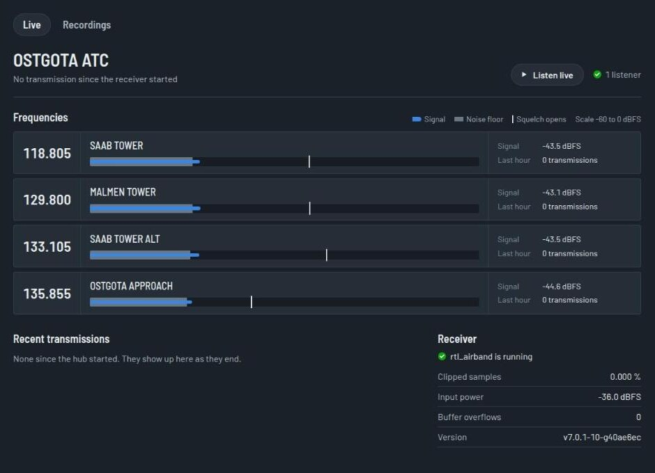
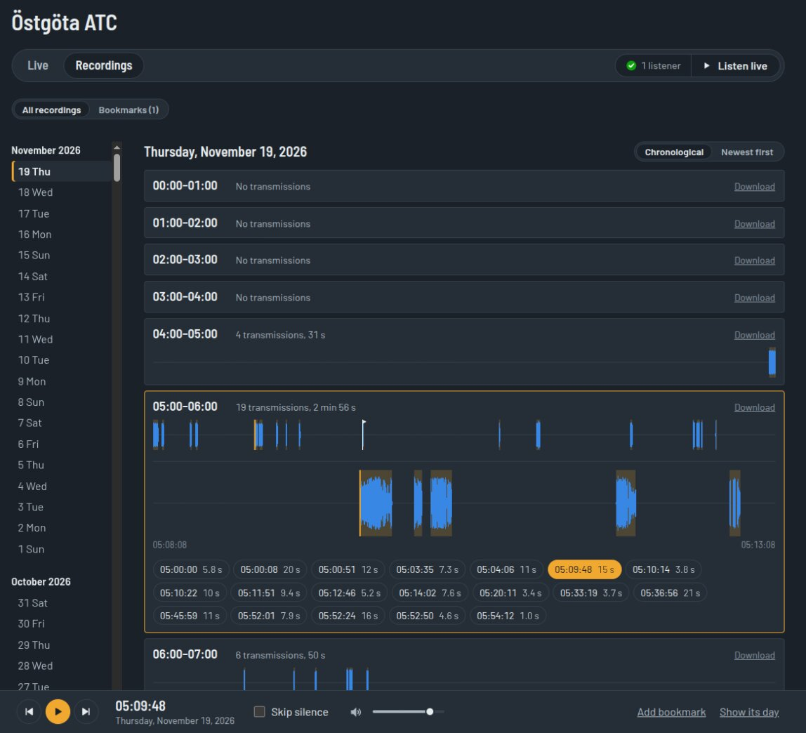

<h1 align="center">airband-hub</h1>

<p align="center">
  <a href="https://github.com/ap-andersson/airband-hub/actions/workflows/image.yml"></a>
  <a href="LICENSE"></a>
</p>

<p align="center">
  <strong>Live stream, dashboard and recordings browser for <a href="https://github.com/rtl-airband/RTLSDR-Airband">RTLSDR-Airband</a>.</strong><br>
  One small container in place of Icecast, a stats scraper and a file server.
</p>

<p align="center">
  
  
</p>

---

RTLSDR-Airband turns an SDR dongle into air traffic control audio. Around it you usually run an
Icecast server for the stream, something to expose its stats, and a web server or Audacity to
find things in the recordings. **airband-hub** does all of that in one Go service with an
embedded web UI, and needs no changes to rtl_airband: it speaks the protocols rtl_airband already uses.

> **Status:** early, but in daily use on a Raspberry Pi 4. See [PLAN.md](PLAN.md) for the design,
> the decisions behind it and the roadmap.

## Features

- **Live stream for any player.** rtl_airband's `icecast` output streams to the hub, and the hub
  serves it to VLC, browsers and phones.
  - Listeners start at the live edge.
  - VLC gets ICY metadata, so it shows the frequency of the latest transmission.
  - An Icecast-compatible `/status-json.xsl` keeps players written for Icecast working, such as
    [tar1090](https://github.com/wiedehopf/tar1090)'s airband player.
- **Live dashboard.**
  - A strip per frequency with the signal level, noise floor and squelch level; it lights up while a transmission is on air.
  - Recent transmissions with their exact length and SNR.
  - Transmissions and airtime per frequency for the last hour.
  - Receiver health: clipping, input power, buffer overflows.
- **Recordings browser.**
  - A waveform for every recorded hour, with transmissions found automatically.
  - Click anywhere to listen from that exact moment.
  - A 5-minute detail view.
  - Jump to the previous or next transmission, or **skip silence** to hear only the transmissions back to back.
  - Download any hour.
- **Light on a Pi.** The hub image is about 11 MB and uses a few MB of RAM. The rtl_airband image
  is 32 MB and runs only `rtl_airband`, where the all-in-one container it replaces was 708 MB.

## How it fits together

```
RTL-SDR ──USB──> rtl-airband ──┬─ MP3 stream + frequency titles (Icecast source protocol) ──┐
                               ├─ hourly MP3 files ──> recordings folder ── read-only ─────┤
                               └─ GET /metrics (Prometheus) ─────── polled every second ───┤
                                       │                                                   ▼
                          Prometheus / VictoriaMetrics                               airband-hub
                                                                ├─ /<mount>.mp3    live stream
                                                                ├─ /               dashboard
                                                                └─ /recordings     recordings
```

The hub implements the server side of the Icecast protocol: `SOURCE`/`PUT` with Basic auth, and
`/admin/metadata` for the titles. rtl_airband's `icecast` output therefore works unchanged; it is
just pointed at the hub. The dashboard reads rtl_airband's Prometheus endpoint (`metrics_listen`),
which comes from the [RTLSDR-Airband fork](https://github.com/ap-andersson/RTLSDR-Airband) and is
not in an upstream release yet.

## Quick start

The repository contains a Docker Compose stack with both rtl_airband and the hub. GitHub Actions
publishes both images for amd64 and arm64: `ghcr.io/ap-andersson/airband-hub` and
`ghcr.io/ap-andersson/rtlsdr-airband` (AM only, from the
[RTLSDR-Airband fork](https://github.com/ap-andersson/RTLSDR-Airband)). The deploy script copies the
compose files to the host over ssh, pulls the images and starts the stack:

```bash
git clone https://github.com/ap-andersson/airband-hub.git
cd airband-hub
cp deploy.env.example deploy.env   # set DEPLOY_HOST (ssh target) and DEPLOY_DIR
scripts/deploy.sh                  # pull the images, start or update the stack
```

To try changes before they are pushed, `scripts/deploy.sh --build` syncs this repository and an
RTLSDR-Airband checkout (`AIRBAND_SRC` in `deploy.env`) to the host and builds both images there.
Running it without `--build` goes back to the published images.

The first deploy creates `DEPLOY_DIR/.env` (mode 600) with a random `HUB_SOURCE_PASSWORD`. Set
`AIRBAND_CONFIG` and `HUB_RECORDINGS_HOST_DIR` in that file, and `COMPOSE_PROFILES=airband` to
start rtl_airband (see [Stack settings](#stack-settings)). In your `rtl_airband.conf`, enable the
metrics endpoint and point an `icecast` output at the hub:

```
metrics_listen = "0.0.0.0:9101";

devices: ({
  # ... your device and channels ...
  channels: ({
    # ...
    outputs: (
      {
        type = "icecast";
        server = "airband-hub";      # the hub's service name in the stack
        port = 8000;
        mountpoint = "atc.mp3";
        name = "My airband";
        username = "source";
        password = "...";            # HUB_SOURCE_PASSWORD from .env
        send_scan_freq_tags = true;  # frequency titles for players and the dashboard
      },
      {
        type = "file";               # recordings for the recordings browser
        directory = "/recording";
        filename_template = "atc";
        continuous = true;
        append = true;
        dated_subdirectories = true;
      }
    );
  });
});
```

Then open `http://<host>:8090/` for the dashboard, or play `http://<host>:8090/atc.mp3` in VLC.

> [!WARNING]
> The hub has **no login yet**. Anyone who can reach it can listen, browse and download every
> recording. Keep it on your LAN until access control exists, which is on the roadmap.

## Configuration

### Hub

The hub is configured with environment variables. In the stack, put them in `DEPLOY_DIR/.env`.

| Variable | Default | |
|---|---|---|
| `HUB_SOURCE_PASSWORD` | (required) | Password for rtl_airband's `icecast` output |
| `HUB_SOURCE_USER` | `source` | Username for it |
| `HUB_LISTEN` | `:8000` | Listen address |
| `HUB_METRICS_URL` | (unset) | rtl_airband's metrics endpoint, e.g. `http://rtl-airband:9101/metrics`. Without it the dashboard shows only the stream. The stack sets it. |
| `HUB_METRICS_INTERVAL` | `1s` | How often to read it |
| `HUB_RECORDINGS_DIR` | (unset) | rtl_airband's file output folder, read-only. Without it there is no recordings page. The stack sets it. |
| `HUB_RECORDINGS_LOCALTIME` | `false` | `true` if rtl_airband runs with `localtime = true`, so file names are in `TZ` instead of UTC |
| `HUB_DATA_DIR` | (unset) | Writable folder for the waveform cache (about 6 KB per recorded hour). Without it, waveforms are only kept in memory and older recordings are not analysed ahead of time. The stack sets it. |
| `HUB_BACKFILL_PAUSE` | `1s` | Pause between analysing older recordings in the background |
| `HUB_BURST_BYTES` | `0` | Recent audio sent to a new listener at once. Playback starts sooner, but the player then stays that far behind live: 24576 is ~4 s at 48 kbit/s. |
| `HUB_SOURCE_TIMEOUT` | `30s` | Drop a source that sends nothing for this long. rtl_airband is silent for ~10 s after connecting while the dongle starts. |
| `HUB_MOUNT_GRACE` | `30s` | Keep listeners connected this long while the source reconnects |
| `HUB_LOG_LEVEL` | `info` | `debug`, `info`, `warn` or `error` |

### Stack settings

These also go in `DEPLOY_DIR/.env`, and are read by `deploy/compose.yml`:

| Setting | Default | |
|---|---|---|
| `COMPOSE_PROFILES` | (unset) | `airband` starts rtl-airband. Leave it unset while another container owns the SDR; the image is still built. |
| `AIRBAND_CONFIG` | `./rtl_airband.conf` | rtl_airband's config on the host |
| `HUB_RECORDINGS_HOST_DIR` | `./recordings` | Where the config's file outputs write. rtl_airband sees it as `/recording`; the hub reads it read-only. |
| `HUB_HOST_PORT` | `8090` | Host port for the hub |
| `AIRBAND_METRICS_HOST_PORT` | `8080` | Host port for rtl_airband's `/metrics`, for Prometheus |
| `HUB_UID`, `HUB_GID` | `1000` | Owner of `data/`, the waveform cache |
| `AIRBAND_IMAGE`, `HUB_IMAGE` | the `:latest` images on ghcr.io | Other images or tags, e.g. a `:sha-<commit>` to pin a version |
| `COMPOSE_FILE` | `compose.yml` | `compose.yml:compose.legacy.yml` lets the hub run next to an older rtl_airband container, by joining its network (`AIRBAND_NETWORK`, default `rtlsdr-airband_default`) |

rtl-airband runs as root, because USB device nodes are usually `root:root 0664`. Its image is
built with `NFM=FALSE`, because NFM support in rtl_airband also doubles the audio rate to 16 kHz.
With `--build`, rebuilding after a change to rtl_airband's code takes seconds: the build tree is
cached between builds.

## Endpoints

| Endpoint | |
|---|---|
| `GET /` | The web UI: dashboard at `/`, recordings at `/recordings` |
| `GET /<mount>` | The live MP3 stream. Players that send `Icy-MetaData: 1` (VLC) get ICY metadata. |
| `GET /status-json.xsl` | Icecast-compatible status: mounts, current title, listeners |
| `GET /api/live` | The dashboard's state as JSON; `/api/live/stream` pushes it every second as server-sent events |
| `GET /api/mounts` | Mounts with their title, listeners and source state |
| `GET /api/recordings/...` | Days, recordings, waveforms, audio from an exact time, downloads ([handlers](internal/recordings/handlers.go)) |
| `SOURCE`/`PUT /<mount>`, `GET /admin/metadata` | The Icecast source side, for rtl_airband |
| `GET /healthz` | Liveness |

## How the recordings work

The recordings page reads rtl_airband's `file` outputs: hourly `<template>_YYYYMMDD_HH.mp3` files,
or the split-on-transmission names. Each file is decoded once into a peak envelope (10 values per
second), and stretches with sound become transmission markers. rtl_airband writes digital silence
while squelch is closed, so they are easy to find. With `HUB_DATA_DIR` set, finished recordings
are analysed in the background, newest first. On a Raspberry Pi 4 that is about 40 hours of
recordings a minute, on one core.

Two details made this harder than expected:

- **8 kHz MP3 is MPEG-2.5**, which pure-Go decoders cannot read. The hub vendors
  [minimp3](https://github.com/lieff/minimp3), a single public-domain C file, and calls it through cgo.
- **Seeking in these files is inaccurate.** They are 98% silence at 8 kbit/s, so a browser's
  size-based seek lands up to half a minute off, and even the files' own VBR seek table is off by
  5 to 15 s. The hub builds an exact frame index instead, and serves audio starting at the exact
  frame for the time you click.

## Development

The UI is Preact + TypeScript + Vite in `web/`. It is built into `web/dist` and embedded in the
Go binary, so build it first. The Go build needs a C compiler, for minimp3.

```bash
(cd web && npm ci && npm run build)
go test -race ./...
go build -o bin/airband-hub ./cmd/airband-hub
docker build -t airband-hub .
```

For UI work with hot reload, run `npm run dev` in `web/`. It forwards the API and the stream to a
running hub, set with `HUB_URL`, e.g. `HUB_URL=http://raspberrypi.local:8090 npm run dev`.

## Related projects

- [RTLSDR-Airband](https://github.com/rtl-airband/RTLSDR-Airband): the receiver this is built around.
  The `metrics_listen` endpoint and the Docker build options come from
  [this fork](https://github.com/ap-andersson/RTLSDR-Airband).
- [docker-rtlsdrairband](https://github.com/ap-andersson/docker-rtlsdrairband): the all-in-one
  container (rtl_airband + Icecast) that this stack replaces.

## Acknowledgements

- [minimp3](https://github.com/lieff/minimp3) by lieff, public domain (CC0), vendored in `internal/mp3`.
- [Preact](https://preactjs.com) and [Vite](https://vite.dev) (MIT).
- The [Barlow](https://github.com/jpt/barlow) typeface by Jeremy Tribby, under the SIL Open Font License,
  through [Fontsource](https://fontsource.org).

## License

airband-hub is free software: you can redistribute it and/or modify it under the terms of the
GNU General Public License as published by the Free Software Foundation, either version 2 of the
License, or (at your option) any later version (`GPL-2.0-or-later`). See [LICENSE](LICENSE).

The vendored [minimp3](https://github.com/lieff/minimp3) in `internal/mp3/minimp3.h` is public domain (CC0).
